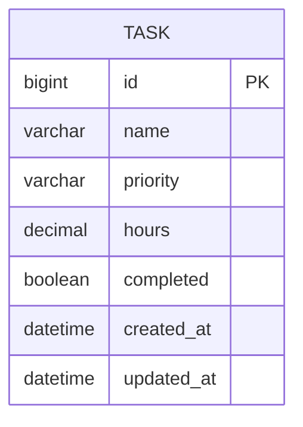

# Evidencias que debes obtener antes de entregar

Las instrucciones piden **modelo de datos, migraciones, scripts SQL, variables de entorno y repositorio GitHub**. Adjunta capturas o demuestra estos puntos personalmente. No se incluyen capturas de pruebas que no se hayan ejecutado.

## 1. Modelo de datos

Abrir `tasks/models.py` y mostrar el modelo `Task`, con `id`, `name`, `priority`, `hours`, `completed`, `created_at`, `updated_at`. El ID es el campo PK de Django.



No hay relaciones adicionales: el diseño original de la Evaluación 1 solo definía tareas.

## 2. Migraciones

En la terminal del computador de entrega:

```powershell
python manage.py makemigrations --check --dry-run
python manage.py migrate
python manage.py showmigrations tasks
```

Mostrar `0001_initial [X]` en la base que realmente uses. Guardar captura real de la salida.

## 3. Scripts SQL y configuración

Mostrar los archivos `scripts/sql/*.sql` y sus comandos `CREATE DATABASE`, `CREATE USER` y `GRANT`. Ejecutar el que corresponda a PostgreSQL o MariaDB y capturar el resultado real. Mostrar `.env` con valores de servidor y `DB_ENGINE`, pero **ocultar `DJANGO_SECRET_KEY` y `DB_PASSWORD`**.

## 4. Proyecto y CRUD REST

1. Mostrar `python manage.py runserver` sin errores.
2. Abrir `/` y registrar una tarea (confirmar persistencia después de reiniciar).
3. Abrir `/api/tasks/` y ejecutar GET, POST, PUT, PATCH y DELETE según `docs/API.md`.
4. Mostrar `python manage.py test -v 2` ejecutado con éxito.

## 5. GitHub

Mostrar URL del repositorio en el navegador, árbol de archivos, historial de commits y `.gitignore`. Comprobar que **NO esté publicado `.env`** y que sí estén las plantillas `.env.example`.

### Lista rápida

- [ ] Modelo Task mostrado
- [ ] Migración 0001 aplicada en la BD elegida
- [ ] Script SQL ejecutado con usuario/permisos
- [ ] .env local mostrado con secretos ocultos
- [ ] API GET/POST/PUT/PATCH/DELETE comprobada
- [ ] Tests ejecutados en tu entorno
- [ ] Repo real subido a GitHub y URL anotada
- [ ] Preparar 5 respuestas para la defensa
